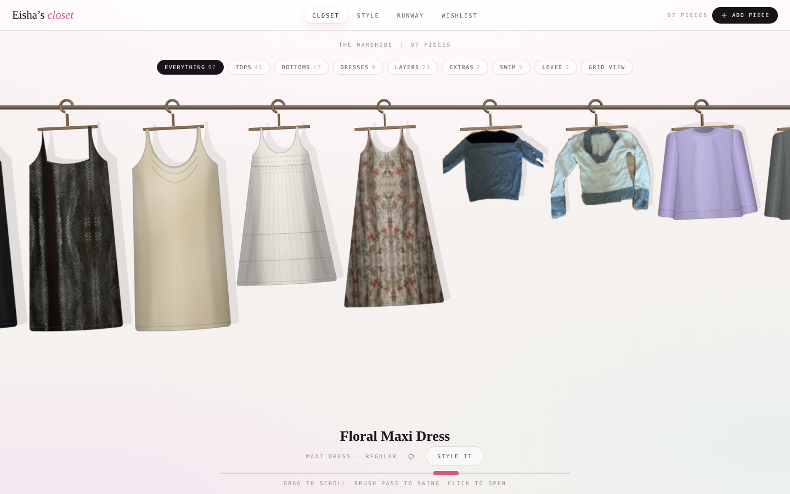

# Eisha's Closet

A personal digital wardrobe. Every piece hangs on an interactive 3D rail you scroll
through; a stylist builds layered outfits from what you own; a dress-to-impress game
scores your looks; and a wishlist tracks what to buy next.



## Tabs

- **Closet** — a real clothing rail rendered in three.js. Drag to scroll, brush past a
  piece to set it swinging, click to open it. Filter by category or favourites, or
  switch to a grid.
- **Style** — pick a mood and the weather and get three outfits with styling notes
  (which side to tuck, what to layer under what, how to wear the jacket) plus shoes and
  accessories you can send to the wishlist. "Style it" on any piece builds looks around
  it. Saved looks live in the Lookbook.
- **Runway** — 14 themed rounds with a timer, three judges and a rank. Dress yourself
  from your own wardrobe, or hit "Style me".
- **Wishlist** — things to buy with price and link. Tick one off and add its photo
  straight to the closet.

## Where the garment images come from

Each piece is either a **photo cutout** (background removed from the original wardrobe
photo) or a **drawn garment** (a vector template tinted to the real colour, with the
actual print or graphic lifted off the photo). `src/source.json` records which is which
— currently 48 photos and 49 drawings. The originals live in `public/wardrobe/photo/`.

Sixteen pieces came from the closet videos: frames were picked automatically where a
garment was held up and still, un-mirrored (the front camera flips everything), and
the garment separated from the person holding it.

To re-render the drawn garments after editing `src/specs.js`:

```bash
npm run dev            # in one shell
node tools/render.mjs  # writes public/wardrobe/gen/*.png
```

## Run it

```bash
npm install
npm run dev
```

`npm run build` emits a static site to `dist/`. Vercel detects Vite automatically.

## Notes

- The starting wardrobe is `src/wardrobe.js`; the stylist's rules are `src/stylist.js`
  (colour pairing, silhouette balance, layering, weather). No API key needed.
- Pieces you add, favourites, saved looks and the wishlist are stored in the browser
  (IndexedDB), so they stay on the device you added them from.
